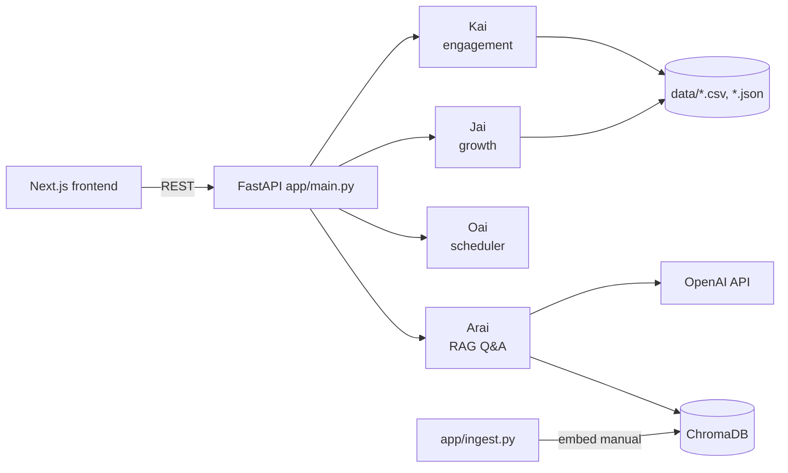

# FAN — Franchise AI Navigator (Backend)

[](https://github.com/classy-j/fan-backend/actions/workflows/ci.yml)

FAN is a set of AI agents that help franchise staff from their first day to their first
promotion: answering onboarding questions from the company manual, building fair shift
schedules, tracking growth, and keeping teams engaged.

Built for the **SAP AI Hackathon 2025** by Jiratip J. and Krittaphas T.
This repo is the FastAPI backend; the Next.js UI lives in
[**fan-frontend**](https://github.com/classy-j/fan-frontend).

## The four agents

| Agent | Role | How it works |
| --- | --- | --- |
| **Arai** | Onboarding Q&A | RAG over the training manual: the PDF is split by section heading, embedded with OpenAI `text-embedding-3-small` into ChromaDB, and answered by `gpt-4o-mini` using only retrieved excerpts. Returns the source section, and refuses when the question isn't covered by the manual. |
| **Oai** | Shift scheduling | Greedy fair-share scheduler: for each shift, picks the available employee with the fewest assigned shifts who is still under their weekly maximum. Supports validated shift swaps between two available employees. |
| **Jai** | Growth & mentorship | Maps each employee's role to a career path (e.g. Barista → Shift Lead), shows the skills needed for the next role, nudges them toward the next missing skill each week, and tracks unlocked skills. |
| **Kai** | Engagement | Idea box with upvotes, team challenges, peer kudos, and a manager summary. |

## Architecture



## Getting started

Requires Python 3.11+ and an OpenAI API key (only for Arai).

```bash
python -m venv .venv && source .venv/bin/activate
pip install -r requirements.txt
cp .env.example .env            # then add your OPENAI_API_KEY
export $(grep -v '^#' .env | xargs)

python -m app.ingest            # build the vector store from data/FAN_Manual.pdf (once)
uvicorn app.main:app --reload   # API on http://localhost:8000, docs at /docs
```

Oai, Jai and Kai work without an API key; only `/ask_arai` and `app.ingest` need one.

### Run the tests

```bash
pip install -r requirements-dev.txt
pytest
```

## API overview

| Method | Endpoint | Agent | Description |
| --- | --- | --- | --- |
| `POST` | `/ask_arai` | Arai | Ask a question about the manual (`{"question", "style": "bullet"\|"sentence"}`) |
| `POST` | `/preview` | Oai | Upload an availability CSV and get it back as JSON |
| `POST` | `/generate_schedule` | Oai | Build a weekly schedule from availability |
| `POST` | `/swap_shift` | Oai | Swap a shift between two employees if both are available |
| `GET` | `/jai/growth/{id}` | Jai | Next role and the skills it requires |
| `GET` | `/jai/nudge/{id}` | Jai | Weekly improvement nudge |
| `GET` | `/jai/skills/{id}` | Jai | Skills unlocked so far |
| `POST` | `/kai/idea`, `/kai/upvote/{id}` | Kai | Submit and upvote ideas |
| `GET` | `/kai/ideas`, `/kai/challenge`, `/kai/summary` | Kai | Ideas, current challenge, manager summary |
| `POST` / `GET` | `/kai/kudos`, `/kai/kudos_list` | Kai | Post and list kudos |

Full interactive docs are served at `/docs` when the API is running.

## Project structure

```text
app/
  main.py          FastAPI routes
  config.py        Paths and settings
  arai_rag.py      Arai: retrieval + answer generation
  ingest.py        Builds the Chroma vector store from the manual
  scheduler.py     Oai: scheduling and shift swaps
  jai_agent.py     Jai: growth path, nudges, skill tree
  kai_agent.py     Kai: ideas, challenges, kudos
data/              Mock café data (manual, employees, career paths, ideas, kudos)
  samples/         Example availability sheet for the scheduler
docs/ci/           Reference DevSecOps pipeline (Nexus + Sonatype IQ)
tests/             API tests
```

All data in `data/` is mock data for a fictional café franchise.

## DevSecOps

Besides the test workflow, this project was used to run a supply-chain-secured pipeline:
dependencies pulled through a Sonatype Nexus PyPI proxy, scanned with Sonatype IQ Server,
and the build published to Nexus. See [`docs/ci/`](docs/ci/README.md).

## Tech stack

Python · FastAPI · ChromaDB · OpenAI API · pandas · pdfplumber · pytest · GitHub Actions
