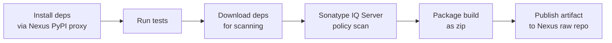

# DevSecOps pipeline (reference)

These two files are the pipelines this project originally ran against a private lab
environment, kept here as a reference for a supply-chain-secured build. They are **not
active**: the live CI for this repo is the plain test workflow in
[`.github/workflows/ci.yml`](../../.github/workflows/ci.yml).

| File | Platform |
| --- | --- |
| `github-actions.nexus-iq.yml` | GitHub Actions on a self-hosted Windows runner |
| `gitlab-ci.nexus-iq.yml` | GitLab CI on a Windows runner |

## What the pipeline does

1. **Dependency proxy**: all `pip` installs go through a Sonatype Nexus Repository PyPI
   proxy instead of reaching PyPI directly, so every package is cached and auditable.
2. **Tests** run with `pytest`.
3. **Software composition analysis**: the resolved dependencies are downloaded and scanned
   with the Nexus IQ CLI against the organisation's security and licence policies.
4. **Artifact publishing**: the packaged build is uploaded to a Nexus raw hosted repository.

Credentials are read from CI secrets (`NEXUS_USER`, `NEXUS_PASS`, `IQ_USER`, `IQ_PASS`).
Hostnames have been replaced with `*.example.internal` placeholders.
